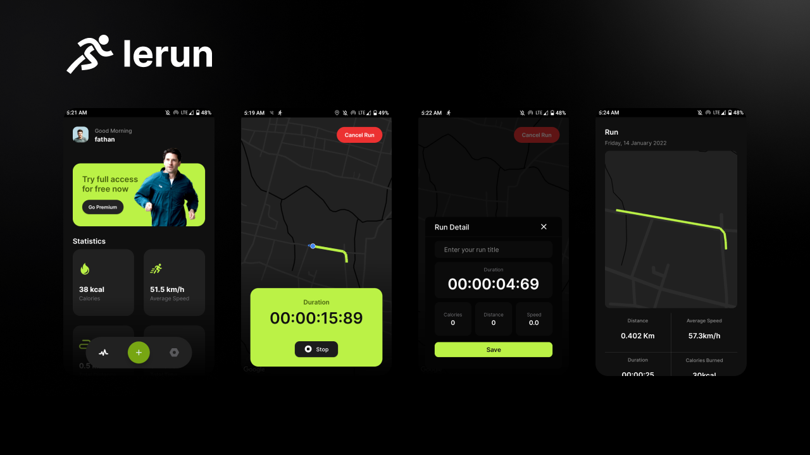
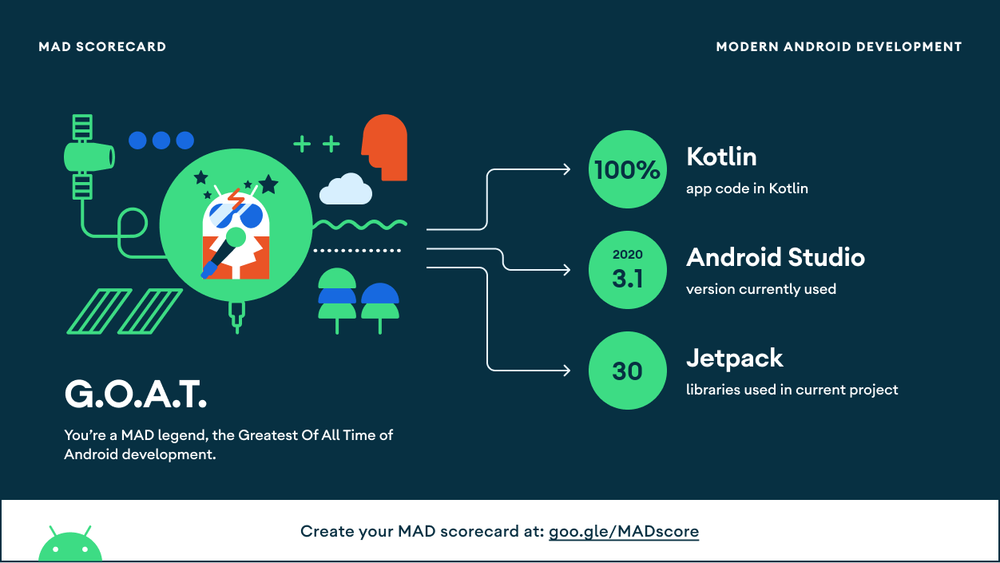
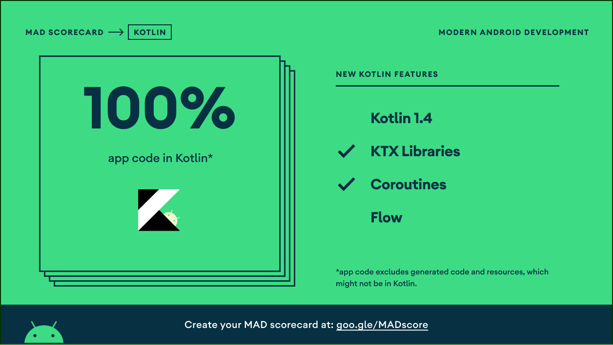
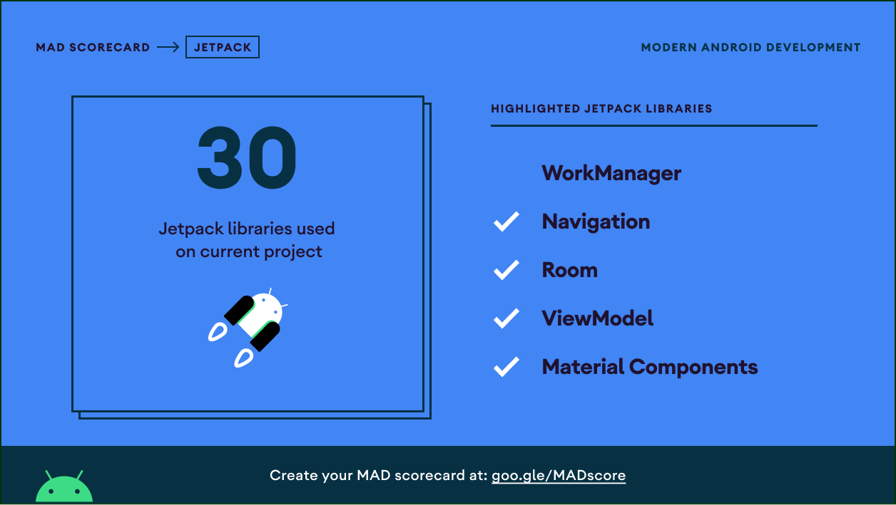

<h1 align="center">Lerun</h1>

<p align="center">
  <strong>A modern Android running & fitness tracker built with Kotlin, Jetpack Compose, and Clean Multi-Module Architecture.</strong>
</p>

<p align="center">
  <a href="https://opensource.org/licenses/MIT"></a>
  <a href="https://android-arsenal.com/api?level=24"></a>
  <a href="https://kotlinlang.org/"></a>
  <a href="https://developer.android.com/jetpack/compose"></a>
  <a href="https://dagger.dev/hilt/"></a>
</p>

<p align="center">
  
</p>

---

## Overview


**Lerun** is an Android running tracker application that records your outdoor runs in real time, visualizes routes on Google Maps, calculates key workout metrics (distance, pace, duration, calories burned), and stores your activity history locally on your device.

### Key Features

- **Real-Time GPS Run Tracking**: Tracks your running route, live duration, distance, average speed, and calories burned using a foreground location service (`TrackingService`).
- **Interactive Route Visualization**: Displays live polylines on Google Maps and captures route snapshots upon completing a run.
- **Run History & Filtering**: Browse recent runs on the home screen or view all runs sorted by Date, Duration, Distance, Average Speed, or Calories Burned.
- **Detailed Run Breakdown**: Inspect individual run metrics, route snapshots, and manage saved runs.
- **Workout Statistics**: Visualize your cumulative progress (total distance, total time, total calories, average speed) alongside interactive bar charts.
- **Personalized Onboarding & Settings**: Set up your profile (name, weight, profile picture with cropping) and toggle between **Dark** and **Light** themes with edge-to-edge system bar support.

<br clear="both"/>

---

## Migration from XML to Jetpack Compose

Lerun originally started as a single-module Android app built with legacy **XML Views, Fragments, and Navigation Component**, and is actively **migrating to 100% Jetpack Compose** alongside a **multi-module Clean Architecture**:

| Area | Legacy (XML) | Modernized (Jetpack Compose) |
| :--- | :--- | :--- |
| **UI Layer** | XML Layouts (`ConstraintLayout`, `RecyclerView`, `CardView`) | Declarative **Jetpack Compose** & **Material 3** |
| **App Structure** | Multiple `Fragment` classes hosted in an XML `NavHostFragment` | Single-Activity (`MainActivity`) with **Compose screens & routes** |
| **Navigation** | Fragment XML Navigation Graph | Type-safe **Jetpack Navigation 3** (`NavDisplay`, `NavBackStack`, `kotlinx.serialization`) |
| **Design System** | XML styles & attributes | Centralized Compose theme (`LerunTheme`, `Color`, `Type`, `Icons`) in `:core:ui` |
| **Visual Effects** | `BlurView` (View hierarchy blur) | Compose-native glassmorphism with **Haze** (`dev.chrisbanes.haze`) |
| **View Interop** | Native XML widgets | Seamless Compose `AndroidView` interoperability for Google Maps `MapView` & `MPAndroidChart` `BarChart` |

> **Current Migration Status**: All core user flows (**Onboarding**, **Home / Run Dashboard**, **Live Tracking**, **All Runs**, **Run Detail**, **Statistics**, and **Settings**) and app navigation have been migrated to Jetpack Compose. Legacy View dependencies (`MPAndroidChart`, Google Maps `MapView`, and `Android-Image-Cropper`) are bridged cleanly via Compose interoperability APIs.

---

## Architecture & Module Structure

The project follows **Clean Architecture** principles combined with **MVVM / Unidirectional Data Flow (UDF)**, organized into feature and core modules for scalability and build performance:

```text
Lerun/
├── app/                   # Application entry point (MainActivity), top-level Navigation 3 host, DI & Services
├── core/
│   ├── common/            # Shared utilities, constants, formatters, and tracking helpers
│   ├── domain/            # Pure business logic: Domain models, Repository interfaces, and UseCases
│   ├── data/              # Data layer: Room database, DAOs, encrypted preferences, mappers & Repository impls
│   └── ui/                # Shared Compose Design System (LerunTheme, typography, colors) & reusable UI components
├── feature/
│   ├── onboarding/        # First-time user setup screen & OnboardingViewModel
│   ├── run/               # Home dashboard, Live GPS Tracking screen, All Runs, Run Detail & TrackingService
│   ├── statistics/        # Running analytics & chart visualization screen
│   └── settings/          # User profile settings, image picker/cropper & theme switching
└── baselineprofile/       # Macrobenchmark & Baseline Profile generator for startup & runtime optimization
```

---

## Tech Stack & Open-Source Libraries

### Core & Asynchronous
- **[Kotlin](https://kotlinlang.org/)**: 100% Kotlin codebase with Kotlinx Serialization.
- **[Coroutines](https://github.com/Kotlin/kotlinx.coroutines) & [Flow](https://kotlinlang.org/docs/flow.html)**: Structured concurrency and reactive state streams (`StateFlow`, `SharedFlow`).
- **Java 11** & **Android SDK**: `minSdk = 24`, `targetSdk = 37`, `compileSdk = 37`.

### UI & Navigation
- **[Jetpack Compose](https://developer.android.com/jetpack/compose)**: Modern declarative UI toolkit with **Material 3**.
- **[Jetpack Navigation 3](https://developer.android.com/guide/navigation)**: Type-safe Compose navigation (`androidx.navigation3:navigation3-runtime` & `navigation3-ui`) with custom hierarchical and top-level transitions.
- **[Haze](https://github.com/chrisbanes/haze)**: Glassmorphism and background blur effects for Jetpack Compose.
- **[MPAndroidChart](https://github.com/PhilJay/MPAndroidChart)**: Interactive bar charts rendered via Compose `AndroidView`.
- **[Android Image Cropper](https://github.com/CanHub/Android-Image-Cropper)**: Profile photo selection and cropping.

### Architecture, DI & Jetpack
- **[Hilt (Dagger)](https://dagger.dev/hilt/)**: Compile-time dependency injection with KSP.
- **[Jetpack Lifecycle & ViewModel](https://developer.android.com/topic/libraries/architecture/lifecycle)**: Lifecycle-aware state holders (`collectAsStateWithLifecycle`, `LifecycleService`).
- **[Room Persistence](https://developer.android.com/training/data-storage/room)**: Local SQLite database abstraction for storing runs, route bitmaps, and user images.
- **[Jetpack Security Crypto](https://developer.android.com/topic/security/data)**: Encrypted `SharedPreferences` for storing user profile settings and theme preferences.
- **[Baseline Profiles](https://developer.android.com/topic/performance/baselineprofiles)**: Ahead-of-time (AOT) compilation profiles for faster app startup and smoother Compose scrolling.

### Location, Maps & Services
- **[Google Maps SDK for Android](https://developers.google.com/maps/documentation/android-sdk/overview)**: Displays live running routes, custom markers, and snapshots.
- **[Google Play Services Location](https://developers.google.com/android/guides/setup)**: `FusedLocationProviderClient` for high-accuracy location tracking.
- **[EasyPermissions](https://github.com/googlesamples/easypermissions)** & Activity Result APIs: Runtime location and notification permission handling.

### Firebase & Tooling
- **Firebase Suite**: Analytics, Crashlytics, Performance Monitoring, Remote Config, Cloud Messaging, and App Distribution.
- **[Timber](https://github.com/JakeWharton/timber)**: Extensible logging utility.
- **[Spotless](https://github.com/diffplug/spotless) + ktlint**: Automated code formatting for Kotlin and Java.

---

## Getting Started & Setup Guide

### Prerequisites

- **Android Studio**: Latest stable version (supporting AGP `9.x` and Compile SDK `37`).
- **JDK**: Java 11 or higher.
- **Android Device or Emulator**: Running Android 7.0 (API 24) or higher with Google Play Services installed.

### 1. Clone the Repository

```bash
git clone https://github.com/arrazyfathan/Lerun.git
cd Lerun
```

### 2. Configure Google Maps API Key

Lerun uses the Google Maps SDK to render live tracking maps and route snapshots.

1. Obtain a **Maps SDK for Android** API key from the [Google Cloud Console](https://console.cloud.google.com/).
2. Update the `google_maps_key` string resource in [`core/ui/src/main/res/values/strings.xml`](core/ui/src/main/res/values/strings.xml):
   ```xml
   <string name="google_maps_key">YOUR_GOOGLE_MAPS_API_KEY</string>
   ```

### 3. Firebase Configuration

The repository includes a sample `app/google-services.json` for development builds. If you want to connect your own Firebase project (for Crashlytics, Analytics, Remote Config, and FCM):

1. Create a project in the [Firebase Console](https://console.firebase.google.com/).
2. Register an Android app with package name `com.arrazyfathan.lerun`.
3. Download your `google-services.json` and place it in the `app/` directory.

### 4. Build and Run

You can open the project directly in **Android Studio** and click **Run**, or build it from the command line:

```bash
# Assemble the debug APK
./gradlew assembleDebug

# Install and launch on a connected device/emulator
./gradlew installDebug
```

### 5. Useful Gradle Commands

```bash
# Run unit tests
./gradlew testDebugUnitTest

# Check code formatting with Spotless (ktlint)
./gradlew spotlessCheck

# Automatically format code with Spotless
./gradlew spotlessApply
```

---

## Download

Go to the [Releases](https://github.com/arrazyfathan/Lerun/releases) page to download the latest APK.

---

## MAD Scorecard





---

## License

```text
MIT License

Copyright (c) [2021] [Ar Razy Fathan Rabbani]

Permission is hereby granted, free of charge, to any person obtaining a copy
of this software and associated documentation files (the "Software"), to deal
in the Software without restriction, including without limitation the rights
to use, copy, modify, merge, publish, distribute, sublicense, and/or sell
copies of the Software, and to permit persons to whom the Software is
furnished to do so, subject to the following conditions:

The above copyright notice and this permission notice shall be included in
all copies or substantial portions of the Software.

THE SOFTWARE IS PROVIDED "AS IS", WITHOUT WARRANTY OF ANY KIND, EXPRESS OR
IMPLIED, INCLUDING BUT NOT LIMITED TO THE WARRANTIES OF MERCHANTABILITY,
FITNESS FOR A PARTICULAR PURPOSE AND NONINFRINGEMENT. IN NO EVENT SHALL THE
AUTHORS OR COPYRIGHT HOLDERS BE LIABLE FOR ANY CLAIM, DAMAGES OR OTHER
LIABILITY, WHETHER IN AN ACTION OF CONTRACT, TORT OR OTHERWISE, ARISING FROM,
OUT OF OR IN CONNECTION WITH THE SOFTWARE OR THE USE OR OTHER DEALINGS IN
THE SOFTWARE.
```
